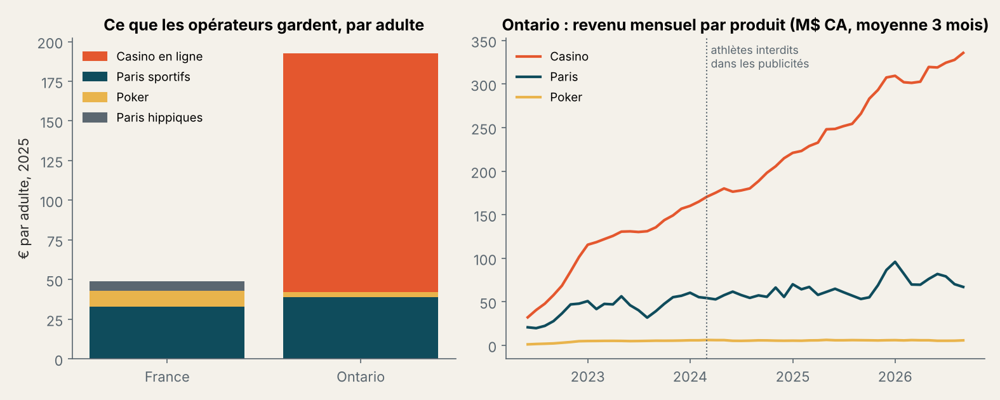
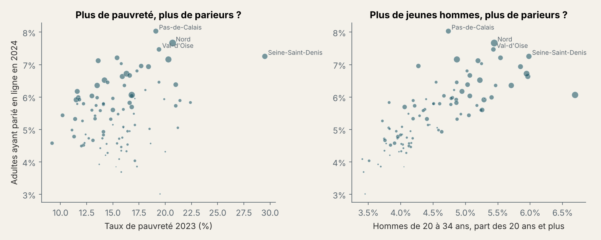
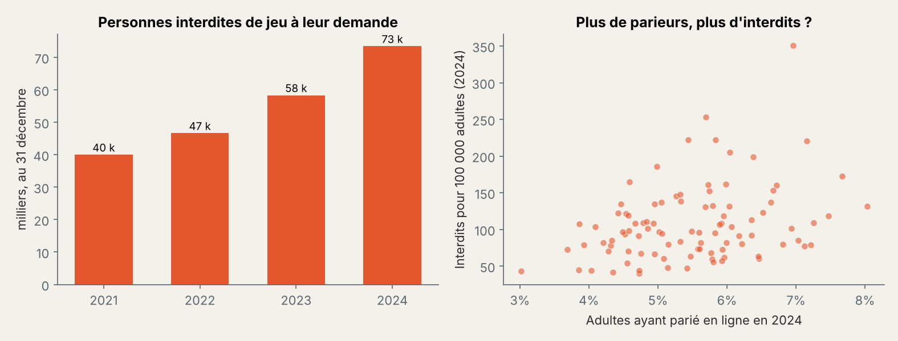
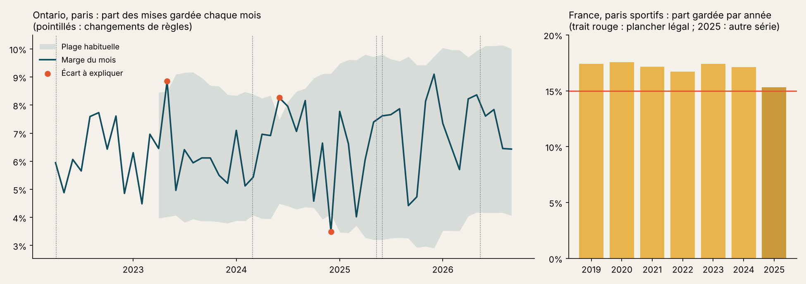

# Parier en France, parier en Ontario

> En 2025, les opérateurs de jeux en ligne ont gardé environ **49 € par adulte en France** et **192 € en Ontario**. L'écart vient presque entièrement du casino en ligne, interdit en France. Sur les seuls paris sportifs, les deux marchés rapportent à peu près autant par adulte, alors que les Ontariens misent beaucoup plus : un parieur français laisse **15 à 18 %** de ses mises à l'opérateur, un parieur ontarien **6 à 7 %**. C'est cohérent avec le plafond légal français de reversement aux joueurs.

Python (pandas, scipy, statsmodels, matplotlib) · SQL · Power BI · données publiques uniquement

---

## Pourquoi ce projet

Deux marchés réglementés, deux choix politiques. La France a ouvert en 2010 un marché en ligne limité (paris sportifs, paris hippiques, poker), sous le contrôle de l'Autorité nationale des jeux (ANJ) depuis 2020. L'Ontario a ouvert le sien le 4 avril 2022 à des opérateurs privés, casino en ligne compris.

Je viens du droit du sport, et je voulais voir ce que ces règles changent dans les chiffres : combien chaque marché rapporte, à qui, et avec quels signaux de risque pour les joueurs.

## Ce que montrent les données

| | France | Ontario |
|---|---|---|
| Revenu des jeux en ligne, 2025 | 2 617 M€ | 4 039 M$ CA, soit 2 559 M€ |
| Par adulte | 49 € | 192 € |
| Casino en ligne | Interdit | 78 % du revenu |
| Paris sportifs, par adulte | 33 € | 39 € |
| Part des mises gardée par l'opérateur (paris) | 15,3 % à 17,6 % selon l'année | 6,1 % à 6,7 % |



**1. Les opérateurs français gardent une part bien plus grande de chaque mise.** De 2019 à 2025, la marge des paris sportifs français ne descend jamais sous 15 % ; en Ontario, elle reste entre 6,1 et 6,7 % sur les années civiles complètes (2023 à 2025), et aucun mois sur 54 ne dépasse 15 %. L'écart est net (Mann-Whitney, p = 0,008). Le droit français impose qu'un opérateur ne reverse pas plus de 85 % des mises aux joueurs : le constat est cohérent avec ce plafond, sans prouver qu'il en est la seule cause (le type de paris et la concurrence jouent aussi).

**2. En Ontario, le casino avale le marché.** La part des paris dans les mises est passée de 21 % la première année à 11 % sur les douze derniers mois (tendance démontrée, rho = −0,83). L'interdiction des athlètes dans les publicités (28 février 2024) n'a pas fait reculer les paris : leurs mises ont augmenté de 16 % l'année suivante, celles du casino de 34 %. Un avant/après sans groupe de comparaison ne permet pas d'isoler l'effet de la règle.

**3. En France, l'âge explique la géographie des parieurs, pas la pauvreté.** La part d'adultes ayant parié en ligne en 2024 va de 3,0 % (Creuse) à 8,0 % (Pas-de-Calais). Elle suit de très près le poids des hommes de 20 à 34 ans dans le département (rho = 0,83). Une fois l'âge pris en compte, ni le niveau de vie ni le taux de pauvreté n'ont d'effet détectable (régression sur 94 départements, R² = 0,66). Ce sont des données par département : elles ne disent rien des individus.



**4. Les interdictions volontaires de jeu progressent beaucoup plus vite que les joueurs.** 40 000 personnes inscrites fin 2021, 73 439 fin 2024 (+84 %), pendant que le nombre de joueurs uniques en ligne progressait de 4 %. Les départements où l'on parie plus comptent un peu plus d'interdits (rho = 0,30). La hausse peut refléter plus de difficultés, ou une démarche mieux connue : les données ne permettent pas de trancher.



**5. Le football écrase tout.** Sur les 100 rencontres les plus pariées en France, 99 sont des matchs de football, dont 24 de l'équipe de France et 22 du PSG.

**6. Une partie du jeu échappe au marché légal, et les deux États ne prélèvent pas de la même façon.** En France, une étude de PwC pour l'ANJ estimait en 2023 le jeu illégal en ligne entre 748 M€ et 1,5 Md€ de produit brut des jeux, l'équivalent d'un tiers à deux tiers du jeu légal en ligne. En Ontario, 91 % des joueurs disent avoir parié au moins une fois sur un site agréé en 2026 (sondage Ipsos), une mesure qui ne dit rien de la part des mises : les deux chiffres ne se comparent pas. Côté État, la France prélève par l'impôt 59,3 % du produit brut des paris sportifs en ligne depuis juillet 2025 ; l'Ontario encaisse comme exploitant, iGaming Ontario gardant environ 20 % du revenu de jeu (181 M$ de dividende versé à la province en 2024-2025). Les parts de marché des opérateurs ne sont publiées par aucun des deux régulateurs : je ne les estime pas.

## Deux pièges dans les données

- **L'ANJ publie deux valeurs pour la même année.** Le PBJ 2024 des paris sportifs en ligne vaut 1 759 M€ dans le *Bilan du marché 2024* (p. 8-9) et 1 599 M€ dans le *Rapport annuel 2025* (p. 15). Aucun des deux documents n'explique l'écart. Je n'additionne jamais les deux séries : 2019-2024 viennent du premier, 2025 du second.
- **Des codes de département impossibles.** Le fichier des interdictions par département contient 14 codes invalides en 2024 (« X », « ZE », « LI »…), soit 31 personnes. Je les écarte et je le signale, plutôt que de les deviner.

## Ce que je proposerais

À un régulateur ou à un opérateur, avec les précautions ci-dessus :

1. **Suivre la marge réelle des paris par type de pari**, pas seulement par opérateur : c'est le levier qui sépare le plus les deux marchés.
2. **Suivre les interdictions volontaires à côté du nombre de joueurs**, par département et par âge, pour savoir si la hausse vient des difficultés ou de la notoriété de la démarche.
3. **Évaluer les règles de publicité avec un groupe de comparaison** (une autre province, un autre produit), puisqu'un simple avant/après ne permet pas de conclure.

Ce sont des pistes, pas des résultats.

## Le suivi de conformité

Le script `suivi_conformite.py` met chaque indicateur face à sa règle, comme le ferait un tableau de bord de responsable conformité (page 5 du Power BI).



- **France :** la part des mises gardée par les opérateurs reste au-dessus du plancher légal de 15 % chaque année de 2019 à 2025, mais elle s'en rapproche en 2025 (15,3 %). Le plafond s'applique à chaque opérateur : un chiffre de marché ne prouve pas que chacun l'a respecté.
- **Ontario :** les normes de l'AGCO ne fixent aucun taux de retour aux joueurs, donc pas de seuil. Je compare chaque mois à sa plage habituelle (moyenne ± 2 écarts-types des 12 mois précédents) : 3 mois sur 42 en sortent (mai 2023, juin 2024, décembre 2024). Ce sont des questions à poser, pas des infractions ; la marge d'un mois dépend aussi des résultats sportifs (hypothèse, non testée ici).
- **Qualité des données :** aucun mois manquant dans la série d'iGO, totaux cohérents à 0,1 M$ près ; deux anomalies françaises signalées (codes de département invalides, deux valeurs du PBJ 2024).

Les changements de règles qui touchent ces indicateurs sont datés et sourcés dans [VEILLE_REGLEMENTAIRE.md](VEILLE_REGLEMENTAIRE.md).

## Ce qu'il faut garder en tête avant de citer ces chiffres

Le PBJ français et le NAGGR ontarien ne se calculent pas tout à fait de la même façon : je compare des ordres de grandeur, pas des montants au centime. Pour l'Ontario, la population adulte est une estimation (13,3 millions de 18 ans et plus, à partir des tranches d'âge publiées, en supposant les âges répartis également entre 15 et 24 ans), et les dollars sont convertis au taux moyen 2025 de la Banque du Canada (1,5782 $ CA pour 1 €). Les chiffres d'iGO ne sont pas audités et sont arrondis ; ceux de l'ANJ viennent de ses rapports, page citée. Tout est agrégé, aucune donnée ne porte sur un joueur.

La partie 10 du notebook reprend chaque affirmation et dit si elle est mesurée, démontrée, non démontrée ou seulement une hypothèse.

## Les données

| Fichier (`donnees/brutes/`) | Source |
|---|---|
| `open-data-repartition-geographique-des-joueurs-2024.csv`, interdictions volontaires (2 fichiers), top 100 des rencontres | ANJ sur data.gouv.fr |
| `ANJ_Bilan_marche_2024.pdf`, `ANJ_Rapport_annuel_2025.pdf`, `ANJ_Rapport_marche_2022.pdf` | anj.fr |
| `iGO_Monthly_Market_Performance_2026-09.xlsx` | iGaming Ontario, publié en octobre 2026 |
| `insee_niveau_vie_median_departement.csv`, `insee_taux_pauvrete_departement.csv` | INSEE (Filosofi 2023) via data.gouv.fr, licence ODbL |
| `insee_estim_pop_dep_sexe_aq_1975_2023.xls` | INSEE, estimations de population au 1er janvier 2023 |
| `donnees/releves/marche_illegal_et_prelevements.csv` | Chiffres publiés, recopiés avec leur source : étude PwC pour l'ANJ, Afjel, ANJ, iGaming Ontario, sondages Ipsos pour l'AGCO et iGO |

Le cadre juridique des deux marchés, et celui des données, est dans [CADRE_JURIDIQUE.md](CADRE_JURIDIQUE.md).

## Reproduire

```bash
pip install pandas numpy matplotlib scipy statsmodels openpyxl odfpy xlrd
```

Ouvrir `paris_france_ontario.ipynb`, puis **Kernel → Restart & Run All**. Le notebook écrit les fichiers de `donnees/exports/` (pour SQL et Power BI) et les graphiques de `images/`. Lancer ensuite `python suivi_conformite.py` pour les tables du suivi de conformité. Les requêtes SQL sont dans [sql/](sql/), le tableau de bord dans [powerbi/](powerbi/).

## In English

France and Ontario both regulate online gambling, with opposite choices: France bans online casino, Ontario opened everything to private operators in 2022. In 2025, operators kept about €49 per adult in France and €192 in Ontario; on sports betting alone, the two markets are close (€33 and €39). French operators keep 15 to 18% of sports stakes, Ontario operators 6 to 7%, which is consistent with the French cap on payouts to players. Across French departments, the share of online bettors follows the share of men aged 20 to 34; once age is taken into account, income and poverty have no detectable effect. Voluntary self-exclusions rose 84% from 2021 to 2024, while the number of players rose 4%. Public data only (ANJ, iGaming Ontario, INSEE).

Justine Meignen
